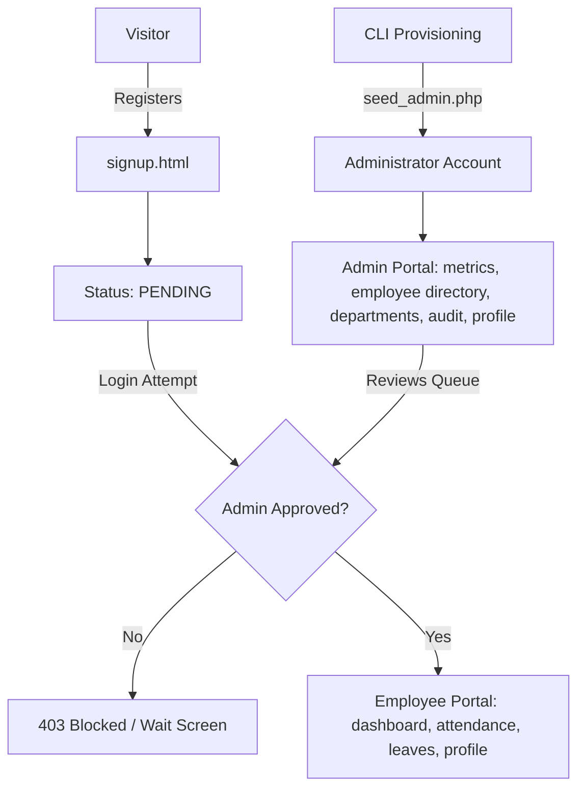

# 🌱 EVORA HRMS — Human Resource Management System

<div align="center">


-2D4739?style=for-the-badge)


<br/>

**A lightweight, responsive, and secure Human Resource Management System engineered with pure web technologies.**  
*Zero framework bloat. Pure native web performance. Calming botanical aesthetics.*

[Quickstart Guide](#-quickstart-guide-in-3-minutes) • [Key Features](#-core-capabilities--key-highlights) • [Design System](#-organic-design-system--palette) • [Role Architecture](#-user-roles--access-control) • [Workflows](#-system-workflows--step-by-step-guides) • [Security](#-defensive-security--architectural-rigor)

</div>

---

## 📖 Executive Summary

**EVORA HRMS** is an institutional-grade workforce management platform developed as a college Web Development demonstration project following strict academic constraints and industry best practices. 

Built entirely from the ground up without relying on external frontend or backend frameworks (no React, Next.js, Vue, TailwindCSS, Laravel, or Node.js), EVORA showcases how clean semantic HTML5, modular CSS custom properties, reactive vanilla JavaScript, and robust Core PHP 8.2 with PDO can deliver an enterprise-grade user experience with sub-millisecond local response times.

---

## ✨ Core Capabilities & Key Highlights

| Feature | Highlight |
| :--- | :--- |
| 🛡️ **Gated Onboarding Pipeline** | Public employee signups enter a strict `pending` queue with dynamic department selection; access is denied until an Administrator verifies and approves the record. |
| ⏱️ **Frictionless Shift Management** | One-click daily clock-in/out with tamper-resistant duplicate shift prevention, real-time status detection (*Present*, *Late Arrival*, *Half-Day*), and calendar history logs. |
| 🌴 **Intelligent Leave Engine** | Built-in annual quotas (12 Casual, 6 Sick days) with automatic balance tracking, multi-format date parser (`YYYY-MM-DD` and `DD-MM-YYYY`), overlap conflict detection, and admin remarks. |
| 📊 **Executive Command Dashboard** | Live operational KPI metric cards, Chart.js turnout rhythm curves, department headcount distribution, and an instant-action approval widget. |
| 🏢 **Department Architecture** | Real-time headcount counters, department code validation (e.g., `ENG`, `HR`, `FIN`), and relational integrity locks that block accidental deletion of populated units. |
| 👤 **Dedicated Dual Profile Hubs** | Tailored profile centers: staff can manage personal contact details while administrators oversee their governance scope and system oversight credentials. |
| 🔔 **Reactive In-App Notifications** | Real-time notification center alerting staff immediately upon registration approval, leave decisions, or organizational announcements. |
| 🔐 **Defense-in-Depth Security** | Prepared PDO SQL statements, BCRYPT password hashing, session fixation prevention, and automated CSRF token injection on mutating requests. |

---

## 🎨 Organic Design System & Palette

EVORA breaks away from generic, clinical software interfaces with a nature-inspired botanical palette tailored to reduce optical fatigue during extended administrative shifts:

```
[#FBF9F5]  Ivory Cream      ─── Soft, welcoming background canvas
[#F4F0E8]  Warm Surface     ─── Elevated container & card panels
[#8A9A86]  Sage Green       ─── Primary branding accents & status badges
[#A3B19B]  Muted Sage       ─── Secondary borders, dividers & hover rings
[#2D4739]  Deep Forest      ─── Primary buttons, active tabs & heavy headings
[#1F3327]  Dark Spruce      ─── High-contrast text & sidebar backgrounds
[#D7A76D]  Warm Amber       ─── Pending badges & notification highlights
[#C86D51]  Soft Terracotta  ─── Rejection tags, alerts & warning prompts
```

---

## 👥 User Roles & Access Control

EVORA strictly enforces **Role-Based Access Control (RBAC)** across all endpoints and views:



### Role Capability Matrix

| System Capability | 🛡️ Administrator (`admin`) | 💼 Employee (`employee`) |
| :--- | :---: | :---: |
| **Account Creation** | Provisioned strictly via secure CLI seeder | Self-service registration via signup portal |
| **Authentication Gate** | Immediate access upon CLI creation | Blocked from login until verified by Admin |
| **Operations Dashboard** | Organization-wide metrics & Chart.js trends | Personal attendance status & leave quotas |
| **Employee Directory** | Full CRUD, approval queue, safe deactivation | Directory access restricted |
| **Department Management**| Create, update, view staff counts & delete | View assigned department |
| **Daily Shift Attendance**| Oversight & audit logs across all units | Daily 1-click Clock-In / Clock-Out |
| **Leave Management** | Review, approve/reject with admin remarks | Submit requests, view quota & track history |
| **Profile Portal** | Governance oversight scope & system specs | Update personal contact info & view records |

---

## ⚡ Quickstart Guide (In 3 Minutes)

### 1. Prerequisites
- **PHP:** Core PHP 8.2 or higher (with `pdo`, `pdo_mysql`, `mbstring`, and `openssl` extensions enabled)
- **Database:** MySQL 5.7+ or MariaDB 10.4+
- **Web Server:** PHP Built-in Server (recommended for dev) or Apache via XAMPP

---

### 2. Environment Configuration
Clone the repository, enter the root directory, and copy the environment template:
```bash
# Windows PowerShell / CMD / Bash:
cp .env.example .env
```
Open `.env` and verify your local database settings:
```ini
APP_NAME="EVORA HRMS"
APP_ENV=development
APP_DEBUG=true
APP_URL=http://127.0.0.1:8000

# Local MySQL Credentials
DB_HOST=127.0.0.1
DB_PORT=3306
DB_NAME=evora_hrms
DB_USER=root
DB_PASS=

# Session Lifetime & Local Timezone
SESSION_LIFETIME=7200
SESSION_SECURE=false
APP_TIMEZONE=Asia/Kolkata
```

---

### 3. Database Initialization & Schema Import

#### Option A: Command Line (Fastest)
```bash
# 1. Create database
mysql -u root -p -e "CREATE DATABASE IF NOT EXISTS evora_hrms CHARACTER SET utf8mb4 COLLATE utf8mb4_unicode_ci;"

# 2. Import schema & seed initial departments
mysql -u root -p evora_hrms < database/evora_hrms.sql
```

#### Option B: phpMyAdmin GUI
1. Open `http://localhost/phpmyadmin/`.
2. Click **New** and create database `evora_hrms` with collation `utf8mb4_unicode_ci`.
3. Select `evora_hrms`, open the **Import** tab, choose `database/evora_hrms.sql`, and click **Import**.

---

### 4. Provision Initial Administrator

To prevent public exploitation, administrative accounts cannot be registered via web forms. Run the secure provisioning tool:

```bash
# Interactive mode (prompts with defaults):
php database/seed_admin.php
```

Or execute directly with CLI flags:
```bash
php database/seed_admin.php --name="Alex Morgan" --email="admin@evora.com" --password="Admin@123456"
```

> [!NOTE]
> **Default Admin Credentials:**
> - **Email:** `admin@evora.com`
> - **Password:** `Admin@123456`
> - **CLI Protection:** `database/seed_admin.php` automatically rejects web browser execution with `HTTP 403 Forbidden` to ensure security.

---

### 5. Launch the Development Server

From the project root (`c:\Users\dell\EVORA`), start the built-in PHP server:
```bash
php -S 127.0.0.1:8000
```

Open your browser and navigate to:
- 🌟 **Landing Portal:** [http://127.0.0.1:8000/](http://127.0.0.1:8000/) *(auto-redirects to `frontend/index.html`)*
- 🔐 **Sign In Screen:** [http://127.0.0.1:8000/frontend/pages/login.html](http://127.0.0.1:8000/frontend/pages/login.html)
- 📝 **Employee Registration:** [http://127.0.0.1:8000/frontend/pages/signup.html](http://127.0.0.1:8000/frontend/pages/signup.html)

---

## 📁 Project Architecture & Directory Structure

```text
EVORA/
├── frontend/                         # Client-side presentation layer (Vanilla HTML5/CSS3/JS)
│   ├── index.html                    # Welcome & landing page
│   ├── pages/                        # Multi-page views
│   │   ├── login.html                # Unified authentication portal
│   │   ├── signup.html               # Employee self-registration (dynamic department loading)
│   │   ├── forgot-password.html      # Self-service password recovery flow
│   │   ├── admin/                    # Protected Administrator Portal
│   │   │   ├── dashboard.html        # Executive metrics & Chart.js visualizations
│   │   │   ├── employees.html        # Employee directory & pending registration queue
│   │   │   ├── departments.html      # Department creation & headcount management
│   │   │   ├── leave-attendance.html # Organizational leave review & attendance audit
│   │   │   └── profile.html          # Administrator oversight profile & governance scope
│   │   └── employee/                 # Protected Employee Portal
│   │       ├── dashboard.html        # Employee daily overview, shift status & leave quota
│   │       ├── attendance.html       # Daily clock-in/out & monthly shift calendar
│   │       ├── leaves.html           # Leave request submission & status tracker
│   │       └── profile.html          # Personal contact details & employment details
│   ├── assets/                       # Static web resources
│   │   ├── css/                      # Global stylesheets (style.css with unified CSS tokens)
│   │   ├── js/                       # Modular scripts & EVORA client SDK (main.js)
│   │   └── images/                   # Visual branding, SVG logos & icons
│   └── components/                   # Modular HTML view partials
│
├── backend/                          # Server-side API layer (Core PHP 8.2)
│   ├── config/                       # PDO Database singleton & .env parser
│   ├── includes/                     # Session guards, CSRF handling & JSON response helpers
│   ├── auth/                         # Authentication endpoints (login, signup, logout)
│   ├── admin/                        # Administrative CRUD endpoints
│   ├── employee/                     # Employee personal operations (attendance, leaves, profile)
│   ├── dashboard/                    # Aggregated analytics & chart endpoints
│   ├── departments.php               # Public & shared department endpoints
│   ├── notifications/                # In-app notification dispatcher
│   └── health.php                    # Database connectivity health check endpoint
│
├── database/                         # Database schema & seeders
│   ├── evora_hrms.sql                # Base relational schema & department seeds
│   └── seed_admin.php                # CLI-only administrator provisioning tool
│
├── docs/                             # Engineering specifications
│   ├── project-overview.md           # High-level architecture & requirements
│   └── database-design.md            # Schema definitions & entity relationships
│
├── .env.example                      # Environment variable template
├── .gitignore                        # Git exclusion rules
└── README.md                         # Project documentation
```

---

## 🧭 System Workflows & Step-by-Step Guides

### 1. 🛡️ Administrator Operations
1. **Sign In:** Navigate to `/frontend/pages/login.html` and sign in with admin credentials.
2. **Operations Dashboard (`admin/dashboard.html`):**
   - Inspect live stats: Active staff headcount, today's attendance turnout, approved leaves, and pending approvals.
   - Review weekly attendance turnout rhythms and department staff allocations via Chart.js.
   - Quick-action review queue displays newly registered employees directly on the dashboard.
3. **Workforce Management (`admin/employees.html`):**
   - **Approval Queue:** Review pending applicants; click **Approve** to activate an account or **Reject** to decline.
   - **Staff Directory:** Search across names, emails, and designations; filter by department.
   - **Safe Deactivation:** Records with historical attendance or leave entries cannot be destructively erased; the system automatically switches them to `rejected` status to preserve audit compliance.
4. **Department Management (`admin/departments.html`):**
   - Real-time staff count reflects the active workforce in each unit.
   - Create new departments with unique shortcodes (e.g. `ENG`, `HR`, `FIN`).
   - Relational deletion lock prevents removing departments that still have assigned staff (`HTTP 409 Conflict`).
5. **Leave & Attendance Audit (`admin/leave-attendance.html`):**
   - Review submitted employee leaves with date ranges and stated reasons.
   - Grant approvals or issue rejections with administrative feedback remarks.
   - Filter daily check-in and check-out logs by specific date and department.
6. **Administrator Profile (`admin/profile.html`):**
   - Review system oversight credentials, authorized permissions, and governance scope.

---

### 2. 💼 Employee Operations
1. **Self-Registration (`frontend/pages/signup.html`):**
   - New employees submit their full name, work email, phone number, and select their department (dynamically populated from the database).
   - The account is registered with status `Pending Approval`.
   - *Gating Protection:* Attempting to log in prior to admin approval displays a clear pending notification.
2. **Employee Workspace (`employee/dashboard.html`):**
   - Today's shift card enables one-click **Clock In** and **Clock Out**.
   - Review remaining annual quotas (12 Casual Days, 6 Sick Days).
   - In-app notification bell reveals real-time alerts when applications are reviewed.
3. **Attendance Portal (`employee/attendance.html`):**
   - One-click daily clock-in/out with anti-tamper logic (cannot clock in twice in the same day; cannot clock out without clocking in first).
   - View monthly calendar logs with color-coded status badges: *Present*, *Late Arrival*, or *Half Day*.
4. **Leave Management (`employee/leaves.html`):**
   - Submit leave applications with start and end dates.
   - Built-in multi-format parser (`YYYY-MM-DD` and `DD-MM-YYYY`) and interactive calendar validation prevent submitting end dates prior to start dates.
   - Overlap validation blocks double-booking existing leave periods.
5. **Personal Profile (`employee/profile.html`):**
   - Inspect verified employment record, designation, department, and join date.
   - Self-service form to update personal full name and contact phone number.

---

## 🔒 Defensive Security & Architectural Rigor

EVORA incorporates standard web security practices across the entire stack:

- 🛡️ **Zero SQL Injection:** All database queries utilize PHP Data Objects (PDO) with strict parameter binding—concatenation in SQL statements is strictly prohibited.
- 🔑 **Cryptographic Password Hashing:** User passwords are encrypted using PHP's native `password_hash()` with `PASSWORD_DEFAULT` (BCRYPT) and verified via `password_verify()`.
- 🍪 **Session Hardening & Fixation Prevention:** Sessions utilize `HttpOnly`, `SameSite=Lax`, and `Strict` cookies. Session IDs are automatically regenerated upon login (`session_regenerate_id(true)`) to defeat session fixation attacks.
- 🎟️ **Automated CSRF Token Validation:** All state-modifying requests (`POST`, `PUT`, `DELETE`) require a valid session CSRF token sent via the `X-CSRF-Token` HTTP header. The client SDK (`EVORA.api`) injects this automatically.
- 🚪 **Server-Side Role Enforcement:** Administrative APIs strictly invoke `requireAdmin()`, while employee endpoints verify `requireEmployee()`. Access is denied on the server regardless of client-side DOM manipulation.
- 🗄️ **Relational Integrity Protection:** Foreign keys ensure that deleting a department with assigned personnel is blocked with an informative `HTTP 409 Conflict` notice until staff are reassigned.
- 🔇 **Zero Credential & Exception Leaks:** All API responses return sanitized JSON messages. Detailed database exception traces and sensitive credentials never escape to the client browser.

---

## 🧪 Verification & Health Checks

### 1. Database Connectivity Health Check
Verify live MySQL database connectivity without exposing credentials:
```bash
php backend/health.php
```
*Expected Output:*
```json
{"success":true,"message":"Database connection successful"}
```

### 2. Backend PHP Syntax Linting
Confirm that all PHP backend files are free of syntax errors:
```powershell
Get-ChildItem -Recurse -Filter *.php | ForEach-Object { php -l $_.FullName }
```

### 3. Safe Administrator Password Reset (CLI)
If you ever need to reset an administrator or employee password safely from the CLI:
```bash
php -r "require 'backend/config/database.php'; \$pdo = Database::getConnection(); \$hash = password_hash('NewPassword123', PASSWORD_DEFAULT); \$stmt = \$pdo->prepare('UPDATE users SET password_hash = :hash WHERE email = :email'); \$stmt->execute([':hash' => \$hash, ':email' => 'admin@evora.com']); echo 'Password updated successfully.\n';"
```

---

## ⚙️ Environment Variables Reference (`.env`)

| Variable | Default Value | Description |
| :--- | :--- | :--- |
| `APP_NAME` | `"EVORA HRMS"` | Human-readable system application title |
| `APP_ENV` | `development` | Environment mode (`development` or `production`) |
| `APP_DEBUG` | `true` | Debug toggle for local development diagnostics |
| `APP_URL` | `http://127.0.0.1:8000` | Base URL used for origin matching & redirects |
| `DB_HOST` | `127.0.0.1` | MySQL server host address |
| `DB_PORT` | `3306` | MySQL server communication port |
| `DB_NAME` | `evora_hrms` | Relational database schema name |
| `DB_USER` | `root` | Database authentication username |
| `DB_PASS` | `""` | Database authentication password |
| `SESSION_LIFETIME` | `7200` | Session idle expiration in seconds (2 hours) |
| `SESSION_SECURE` | `false` | Set `true` if serving over HTTPS in production |
| `APP_TIMEZONE` | `Asia/Kolkata` | Application timezone for shifts and timestamps |

---

## 📌 Educational Scope & Constraints

- **Framework-Free by Design:** Built strictly with vanilla HTML5, CSS3, ES6+ JavaScript, and Core PHP 8.2 to demonstrate mastery of core web standards.
- **Local-First Architecture:** Password recovery and alerts are presented via interactive modal dialogs and in-app notification widgets, enabling full offline evaluation without third-party SMTP relay dependencies.

---

<div align="center">

Crafted with care for **EVORA HRMS** • College Web Development Project  
*Pure Vanilla Web Technologies • Botanical Aesthetics • Enterprise Architecture*

</div>